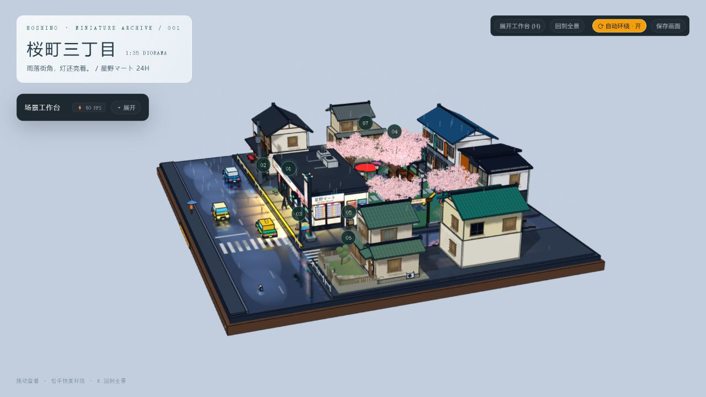
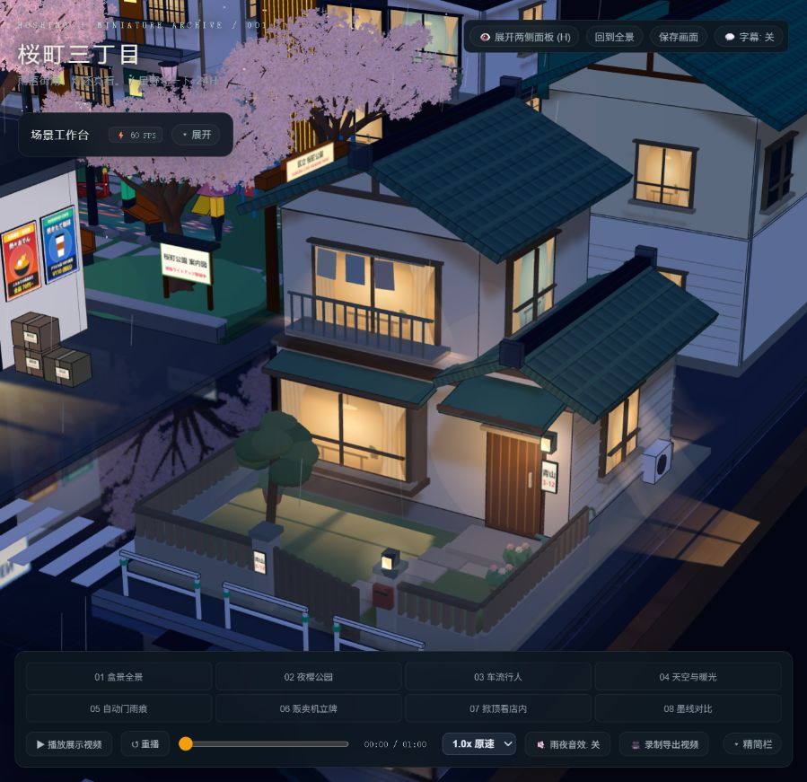
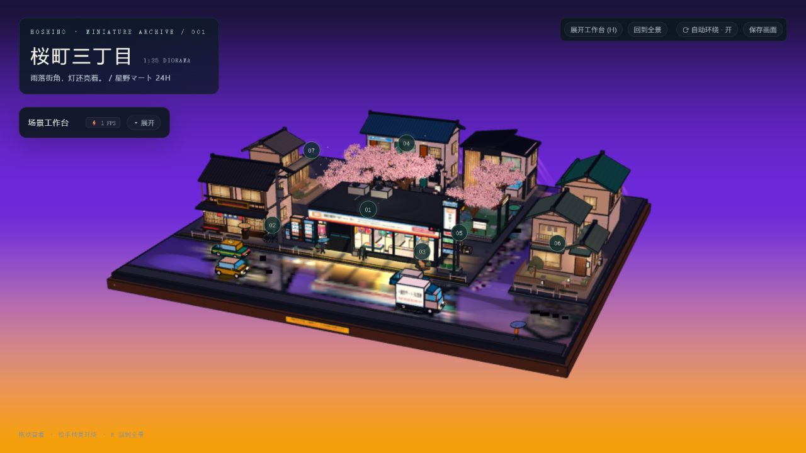
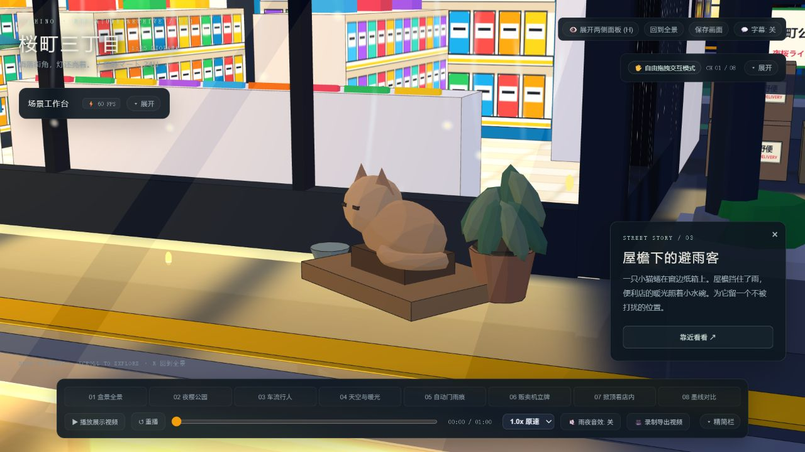

# 桜町三丁目 · 星野マート 24H (Hoshino Miniature Diorama)

> 一个基于 **Three.js** 与 **GSAP** 构建的 3D 日漫“三渲二”卡通风格微缩街景盒景（Diorama）交互项目。



---

## 📖 项目简介

**「桜町三丁目 · 星野マート 24H」** 是一个充满日式生活气息的 3D 微缩场景。场景构建在精致的胡桃木纹底座上，还原了夜幕下的日式街角便利店、樱花公园与生活街区：

- 🏪 **星野便利店 24H**：包含完整的便利店室内货架、暖黄灯光、侧门补货区与自动门。
- 🏡 **昭和风与木造街区**：包含昭和绿瓦独栋、凸窗、半开木门、木造障子与縁側水钵石庭，搭配 48 处柔和的住宅窗光投影与体积光束。
- 🌸 **夜樱公园**：立体分叉枝干与密集的五瓣樱花花簇。
- 🌧️ **动态天气与氛围**：支持无降水、雨夜（湿路地面实时镜面反射）与雪景（屋顶积雪、路沿雪堆、车辙与戴帽雪人）一键切换，以及黄昏到深夜的日式天空渐变。
- 🔍 **街角故事探索**：内置 7 个精心编排的电影感特写镜头（避雨小猫、自行车、昭和小院、石庭等），支持点击标记平滑推进观察。
- 📦 **零依赖单文件运行**：通过 esbuild 离线打包，双击 `index.html` 即可在任何现代浏览器中畅快体验，无需配置环境或联网 CDN。

---

## 🖼️ 场景展示

| 绿瓦昭和小院 | 黄昏氛围与天际线 | 窗边避雨小猫 |
| :---: | :---: | :---: |
|  |  |  |

---

## 🚀 快速上手

### 1. 直接运行（离线版）
- 无需安装任何运行环境，直接双击根目录下的 **`index.html`**。
- 使用任何支持 WebGL 2 的现代浏览器（Chrome、Edge、Safari、Firefox）即可流畅浏览。

### 2. 源码修改与重新打包
如果你想自行修改场景：
```bash
# 安装依赖 (Three.js, GSAP, esbuild)
npm install

# 重新构建单文件 index.html
npm run build
```

---

## 🕹️ 交互与操作指南

- **视角控制**：
  - **鼠标左键拖动**：自由旋转视角。
  - **鼠标右键拖动**：平移视角。
  - **滚轮滑动**：推进或远离镜头。
- **自动巡游**：开场默认开启平滑自动环绕（正面约 3.5°/s，侧面约 4.375°/s，连续平滑变速），用户手动介入后自动暂停并在闲置 2.5 秒后平滑恢复。
- **故事特写**：点击场景中的圆形数字标记（`01`~`07`）或左侧故事按钮，相机将自动平滑推进至对应特写机位；再次点击返回完整盒景。
- **快捷键**：
  - `R`：重置并返回完整盒景视界。
  - `H`：折叠 / 展开左上角「场景工作台」。
  - `Esc`：关闭当前细节卡与特写。
- **工作台面板**：
  - **天气切换**：自由切换晴朗白昼、雨夜与雪景，调节降水粒子密度。
  - **保存画面**：一键导出无 UI 遮挡的当前纯 3D 渲染高清 PNG 截图。
  - **住宅窗光**：实时控制全街区 48 处住宅窗光与柔光束强度。

---

## 📝 迭代历史与主要更新

### 🌸 场景建模与环境重构
- **樱花树全面立体化**：移除扁平盘状树冠和十字花贴片，改用分叉枝干与高密度立体五瓣花簇，补足盛放期树冠的立体厚重感。
- **住宅立面与院落新增**：
  - 右前方新增**昭和绿瓦独栋**：配有凸窗、晾衣阳台、门柱信箱、半开木门、石板步道与花木小院（机位 `06`）。
  - 西侧新增**传统木造住宅**：配有障子窗、縁側外廊与水钵石庭（机位 `07`）。
  - 完善古书店、茶屋、公寓立面细节（落水管、侧窗、空调外机等）。
- **微缩底座质感升级**：引入胡桃木纹材质与黄铜固定构件，边缘适配视口比例。

### 💡 灯光与三渲二渲染管线
- **48 处统一窗光与柔光束**：全街区建筑亮窗接入投影与柔光束，二楼光束精确收敛于阳台与屋檐表面，支持光效独立调节。
- **天空与反射管线修正**：黄昏模式恢复紫金色渐变与紫色环境光；正确处理输出色域与实时反射视口同步。
- **高清门头与路面标线**：门头升级为高清各向异性过滤贴图；交通标线直接由柏油路面 Shader 结合屏幕导数抗锯齿绘制，消除低机位深度冲突（Z-fighting）。

### ❄️ 天气系统与粒子优化
- **雪景模式重做**：屋顶及地面覆雪、路沿自然雪堆、轮胎车辙印与戴帽雪人；雪花粒子基于三维世界空间独立运动，不受相机视角旋转影响。
- **粒子缓冲共享**：雨雪天气共用一套粒子缓冲区，按需按绘制范围单独渲染，杜绝多余内存开销。

### ⚡ 性能与合批优化
- **绘制调用大幅缩减**：按材质与空间分块合并静态建筑、墨线和加法光效，静态网格冻结矩阵计算。在历史测试基准中，Draw Call 从约 4916 次骤降至 2028 次（降幅约 **59%**），保证低配设备也能稳定 60 FPS。
- **无感适配移动端**：适配 390×844 等主流手机视口与触控操作，页面切入后台时自动暂停渲染节约性能。

---

## 🛠️ 技术栈与依赖

- **3D 引擎**：[Three.js](https://threejs.org/) (`0.170.0`)
- **动效与相机缓动**：[GSAP](https://greensock.com/gsap/) (`3.12.5`)
- **打包工具**：[esbuild](https://esbuild.github.io/) (`0.25.12`)
- **许可协议**：第三方库版权声明详见 [THIRD_PARTY_NOTICES.txt](THIRD_PARTY_NOTICES.txt)。
